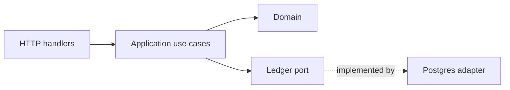
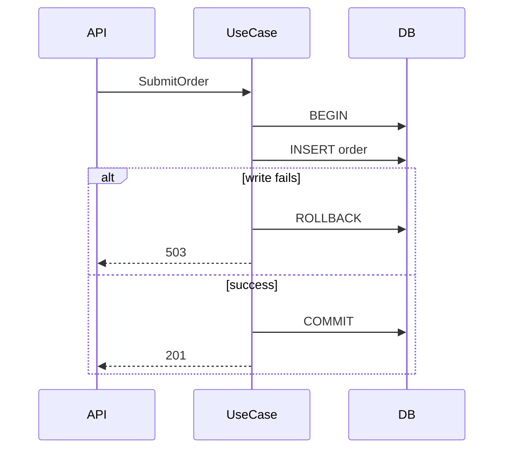

# Open PR

Turn a finished implementation into a pull request a reviewer can act on.

This skill owns the author side. To review someone else's PR, use
`prepare-pr-review`. To judge a diff, use `code-review`.

## When to use

- the change is implemented and verified, and a PR must be opened;
- a PR body exists but reads as a file list, a changelog, or a restatement of the
  diff.

Do not use for a change you have not verified — run `run-verification` first — or
for triage of a PR you did not write.

## Sources, in order of authority

1. The implementation plan, RFC, or ADR.
2. The verification output actually produced.
3. The diff.
4. The commit history.

The plan is the authority for intent and structure; the diff is the authority for
what the code does. When they disagree, say so in the body instead of papering
over it. The reviewer will find the divergence anyway, and finding it in the body
costs less than finding it in the code.

## Body structure

Omit a section rather than fill it. An empty section is a lie with better
formatting.

### What changed

Behavior, not files. One or two sentences per meaningful change. A reviewer
should be able to decide whether to read further from this section alone.

### Why

The problem, the decision, and the alternative that was rejected. Link the plan,
RFC, or ADR — that link is what lets a reviewer compare code against intention
rather than against taste.

Write this section before `What changed`. It exposes changes the intent does not
justify.

### Diagrams

Copy the plan's component and sequence diagrams. They convey structure faster
than any prose, and they give the reviewer something to compare the code against.

- Component: modules and dependency direction, 3 to 12 nodes, one edge per real
  dependency, no class diagrams.
- Sequence: only the riskiest flow, including the partial-failure branch.
- If the plan has no diagram, author one now and say it was authored at PR time.
  Never present a diagram written after the fact as the approved design.
- Store it in the repository too (`docs/`, ADR). A diagram that lives only in the
  PR thread dies with the thread.

### Risk and blast radius

What breaks if this is wrong: affected callers, stored data, external contracts,
migrations, feature flags. Name the failure mode instead of writing "low risk".

### Verification

Commands actually run and what they returned. Not "tests pass". If something was
not verified, name it and say why.

### Where to look

Three to five bullets pointing at the areas that deserve attention and the
question to ask of each. Keep it short — the full reading guide belongs to
`prepare-pr-review`, not to the author.

## Process

1. Collect the plan, the verification output, and the diff.
2. Draft `Why`, then `What changed`, then the rest.
3. Validate that every Mermaid block renders: `mmdc -i diagram.mmd -o diagram.svg`,
   or confirm the fenced block renders on GitHub. Never publish an unrendered
   block.
4. Write the body to a file and open the PR with
   `gh pr create --title "..." --body-file body.md`. A long body passed inline
   through the shell mangles quotes, backticks, and code fences.
5. Read the rendered PR page once. Confirm the diagrams rendered and every link
   resolves.

## Rules

- One PR, one reviewable intent. If `Why` needs three paragraphs, split the PR.
- Never claim a check you did not run, or a test that does not exist.
- Do not paste a file-by-file diff summary; the diff already shows that.
- If the implementation diverges from the plan, state the divergence and the
  reason. Hiding it turns a design question into a review ambush.
- Keep the body proportional. A one-file fix does not need seven headings.

## Output

A PR body file plus the opened PR URL, or the body alone when the user opens the
PR themselves.
